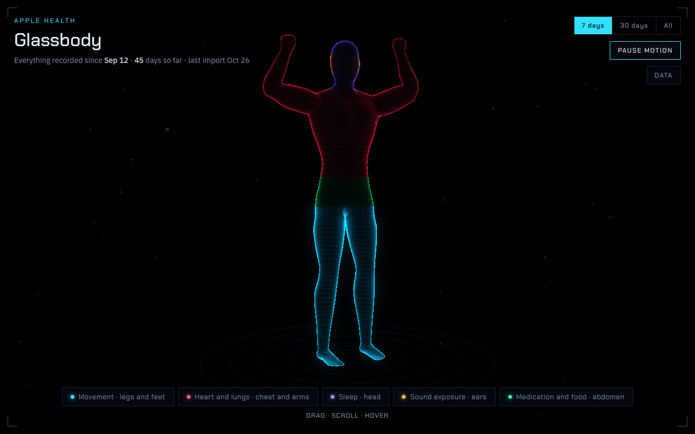

# Glassbody

Glassbody shows your Apple Health data on a rotating figure, in a web page
that reads your export and keeps it in your own browser.



## Try it

1. Open <https://glassbody-app.github.io/>.
2. The Data panel opens on the first visit. Load the sample to look around,
   or import the zip that Health Auto Export makes (see
   [Where the data comes from](#where-the-data-comes-from)). On a computer you
   can also drop the zip anywhere on the page.
3. Install it if you want it as an app: on iPhone and iPad, Add to Home Screen
   (see [On iPhone and iPad](#on-iphone-and-ipad)); in Chrome and Edge, the
   install button in the address bar.

After the first visit the page works offline, installed or not.

Drag the figure to turn it and scroll to zoom. Hovering over a body region, or
tapping it, shows a summary; clicking it, or its button under the figure,
opens a page of charts:

| Region | Page |
| --- | --- |
| Legs and feet | Movement: steps, walking pace, daylight, step length, asymmetry, every tracked walk with its route and heart rate |
| Chest and arms | Heart and lungs: resting rate, variability, blood oxygen, breathing rate, alerts, ECG readings, fitness measures |
| Head | Sleep: hours by stage per night |
| Ears | Sound exposure: environment and headphone levels |
| Abdomen | Medication and food: logged doses and nutrition |

## Privacy

Your health records never leave the browser. The zip is read on your device
and the records are kept in the browser's IndexedDB. Glassbody has no server
of its own, no account and no analytics, and sets no cookies.

The page makes these network requests and no others:

- Files from the site itself: the page, its scripts, styles, typefaces and
  icons, the web app manifest (`manifest.webmanifest`), the service worker
  (`sw.js`), the figure (`data/body.json`) and the sample
  (`data/sample.json`). On the first visit the service worker downloads all
  of them, the sample included, and keeps a copy so the page works offline.
  The browser may also ask for `favicon.ico`, which the site does not have.
- three.js, d3 and JSZip from `cdnjs.cloudflare.com`. The service worker
  keeps a copy of these too.

GitHub hosts the site, so it sees your IP address and which of these files
your browser asks for, as any web host does. GitHub says it logs the IP
address of every visitor to a Pages site ([GitHub Docs, "What is GitHub
Pages?"](https://docs.github.com/en/pages/getting-started-with-github-pages/what-is-github-pages#data-collection)).
cdnjs sees your IP address and the site's address. The requests to cdnjs,
the page's and the service worker's, carry no referrer, so they do not say
which page asked; tests check both.

The script tags carry integrity hashes, so the browser refuses a library file
that cdnjs serves changed, and the service worker refuses to keep a copy of
one. A Content-Security-Policy in `index.html` blocks requests to any other
host. A test uses every page and the Data panel and fails on any request
outside the site and cdnjs. To avoid cdnjs as well, serve the page yourself
and open `index.local.html` (see [Running it locally](#running-it-locally)).

## Where the data comes from

Glassbody reads the zip made by the iOS app
[Health Auto Export](https://apps.apple.com/us/app/health-auto-export-json-csv/id1115567069).
Its manual export needs the app's Basic tier, which cost $2.99, one time, on
the US App Store on 2026-11-05. The free tier has widgets and charts only.

In Health Auto Export, use Export All with the format set to CSV and
aggregation set to Sum. The steps inside the app are left to the app itself.

Each new export is merged into what is already stored, so the history grows
past the window of any one export. Importing an overlapping export adds only
the records that are new. The Health app's own export is not read yet.

## On iPhone and iPad

A web app on the Home Screen keeps its own records, apart from Safari's.
Add Glassbody to the Home Screen first and import there; records imported in
Safari don't show up in the Home Screen app.

1. Open <https://glassbody-app.github.io/> in Safari. Tap the menu button at the
   left of the address bar, then Share, then View More, then Add to Home
   Screen. Leave Open as Web App on and tap Add.
2. Save your Health Auto Export zip to the Files app.
3. Open Glassbody from the Home Screen. The Data panel opens on the first
   visit; after that, tap Data. Tap "choose a file". The Files picker opens;
   go to the folder with the zip and tap it.

Download backup saves `glassbody-backup-<date>.json` to Files, in On My
iPhone, Downloads, once you tap Download in Safari's prompt. Restore backup
reads it from there.

If you imported in Safari before adding the app, tap Download backup in
Safari, then Restore backup in the Home Screen app.

These steps were checked in Xcode's iOS Simulator, on a simulated iPhone 18
Pro with iOS 27.2 (`docs/decisions.md`, 2026-11-10). They have not been tried
on a real iPhone, on iPad or on other iOS versions.

## Keeping your data

The records live in the browser's IndexedDB, under the site's address. Each
address has its own store, and on iPhone and iPad a Home Screen app has its
own too. Besides the records, the page keeps one setting in localStorage: the
Pause motion choice.

After an import that adds records, and after a restore, the page asks the
browser to make its storage persistent, so the browser does not clear it by
itself when space runs low. Firefox asks you with a prompt; Chrome, Edge and
Safari decide on their own and show nothing
([MDN, "Storage quotas and eviction criteria"](https://developer.mozilla.org/en-US/docs/Web/API/Storage_API/Storage_quotas_and_eviction_criteria)).
The page does not show the answer.

Safari deletes what a site has stored after 7 days of Safari use without a
visit to that site. A web app on the Home Screen keeps its own count of days,
and WebKit does not expect its data to be deleted
([WebKit, "Full Third-Party Cookie Blocking and More"](https://webkit.org/blog/10218/full-third-party-cookie-blocking-and-more/)).
On iPhone and iPad, and in Safari on a Mac, the Data panel says so in a note
unless the page runs as an installed app. WebKit does not say whether a web
app added to the Dock on a Mac is spared, so on a Mac the note asks for a
backup after each import.

Download backup in the Data panel saves every record in one JSON file;
Restore backup reads it back, and asks before it replaces what is stored. A
backup holds every record, medication and each walk's GPS route included, so
keep it somewhere private. The Data panel shows the day of the last backup
downloaded from this browser, and an import that adds records ends with a
reminder to download one. The page cannot tell whether the file was saved,
so the line says "downloaded".

Erase in the Data panel deletes the browser's database for the page.
Clearing the site data for the address in the browser's settings does the
same.

## Running it locally

Get the code from <https://github.com/glassbody-app/glassbody-app.github.io>, with
`git clone` or as a zip from that page. Any static file server works. From
the folder that holds `index.html`:

```bash
python3 -m http.server 8000 --bind 127.0.0.1
```

Then open <http://127.0.0.1:8000/>. On the first visit the Data panel opens.
Load the sample to look around, or import an export, then close the panel to
see the figure. `index.html` loads the three libraries from cdnjs, so the
first visit needs an internet connection. Served this way, it installs the
service worker for that address, as the hosted page does.

The server publishes every file in the folder, including `.git` and any
export or backup you save there. Without `--bind 127.0.0.1` it listens on
every network interface, so anyone on the same Wi-Fi can download those
files.

Every page served from one address shares that address's browser storage.
If you serve other projects at `http://127.0.0.1:8000/`, their scripts can read
the records Glassbody keeps there. A name of its own keeps them apart: open
<http://glassbody.localhost:8000/> instead. Chromium sends any `*.localhost`
name to this computer; the test suite checks that, and other browsers have not
been tried. Each address has its own store, so a new address starts empty:
download a backup at the old one and restore it at the new one.

Opening `index.html` straight from disk (a `file://` address) does not work:
the browser refuses to load the figure and the local libraries. The page says
so and names the command above.

`index.local.html` loads the three libraries from `vendor/` instead, so it
makes no request to cdnjs. It is not in the download: run
`sh test/vendor.sh` (or `npm run vendor`) once, which needs `curl`, `sed` and
an internet connection, downloads the libraries from cdnjs into `vendor/` and
writes `index.local.html`. Then open
<http://127.0.0.1:8000/index.local.html>. It does not install offline
support, because the service worker's own downloads would still go to cdnjs.
If `index.html` was opened at the same address first, its service worker has
already fetched the libraries from cdnjs and answers `index.local.html` too;
to keep cdnjs out, open only `index.local.html` at that address.

`tools/ingest.py` does the same parsing and merging from the command line and
writes the store as JSON, by default to `~/glassbody/health.json`, outside
the repository, so the server above never publishes it. A new export is
merged into the `--out` file if it already exists; `--store` merges from a
different file, and `--fresh` starts from nothing:

```bash
python3 tools/ingest.py export.zip
```

The page does not read that file. It is there to check the browser parser
against, and for anyone who wants the data outside the browser. How the
parser, the merge and the figure work, and the bugs they guard against, is in
[docs/architecture.md](docs/architecture.md). Running the tests and changing
the code are covered in [CONTRIBUTING.md](CONTRIBUTING.md).

## Troubleshooting

- The page refuses the export because "cumulative metrics look averaged", or
  the step counts it shows are a thousand times too small. Health Auto
  Export's aggregation was set to Average. Set it to Sum and export again.
- The page says the file "is not a zip file". The zip was unpacked on the
  way, or a different file was picked. Export again and import the zip as it
  is.
- No figure, only a line of text. "This view needs WebGL" means the browser
  has WebGL or hardware acceleration turned off; turn it on in the browser's
  settings. "This page does not work opened from disk" means `index.html` was
  opened as a file; serve the folder as in
  [Running it locally](#running-it-locally).
- Your data is gone in Safari. Safari deleted it after 7 days of use without
  a visit. Restore your last backup, and add Glassbody to the Home Screen
  (see [On iPhone and iPad](#on-iphone-and-ipad)).
- Records imported in Safari are missing from the Home Screen app. The two
  keep separate records. Download a backup in Safari and restore it in the
  Home Screen app.
- An old version shows after an update. Reload once while online. The page
  fetches its files from the site first and uses its offline copy only when
  the network fails.
- An export or a backup is refused as too large. The page refuses a zip over
  500 MB, a file it reads inside the zip that unpacks to more than 50 MB,
  files it reads that together unpack to more than 200 MB, and a backup over
  100 MB. Shorter exports, imported one after another, are merged into the
  same store.
- Erase says Glassbody is open in another tab. Close that tab; the erase
  finishes once it closes.

## The figure

The source mesh is `data/raw/astra_figure.stl`, a muscular man with raised
fists, 10,528 triangles. OpenAI's GPT-6 Astra built it for this project in
November 2026, from a brief that ruled out existing models and assets.
`tools/refine_figure.py` thickens its legs, arms and torso and scales the head
up, and `tools/body_from_stl.py` remeshes the result into one skin of 9,000
triangles split into the five regions, which is `data/body.json`. The figure
is under the MIT licence, like the code. The Blender commands that rebuild it
are in [CONTRIBUTING.md](CONTRIBUTING.md#rebuilding-the-generated-files).

## Dependencies

| What | Version | Used for |
| --- | --- | --- |
| three.js | 0.160.1, from cdnjs | the figure. The last release with the UMD build that classic scripts need; do not bump it without moving to ES modules |
| d3 | 7.9.0, from cdnjs | charts |
| JSZip | 3.10.1, from cdnjs | reading the export in the browser |
| Python | 3.13, standard library only | `tools/ingest.py`, `tools/make_sample.py` |
| Node.js | 22 | the test suite and the icon and screenshot tools only |
| @playwright/test | 1.64.1 | the test suite and the icon and screenshot tools only |
| Blender | 5.2.3 | `tools/refine_figure.py`, `tools/body_from_stl.py` and `tools/make_body.py` only |
| Chakra Petch, IBM Plex Sans | latin and latin-ext files as Google Fonts served them on 2026-10-28, in `fonts/` | the typefaces |

`requirements.txt` has no packages to install; it records the Python version.
The page itself has no build step.

## Known gaps

- Only the manual Export All zip is parsed. Health Auto Export's scheduled
  automations write a different layout, and its REST payload is different
  again.
- Built for a desktop browser. It works on a phone but is cramped.
- On a touch screen, a region's summary card can stay open over the figure
  after going back from its page.
- The automated tests run in Chromium only. Safari is checked by hand in the
  iOS Simulator.
- `data/body.json` is 183 KB, the largest file the page loads.
- Number parsing differs at the edges between the two ingesters: the browser
  accepts `0x10` and rejects `1_000`, Python does the opposite. No real export
  has been seen with either.
- A zip whose file names are marked UTF-8 but are not is refused by
  `tools/ingest.py` (Python's `zipfile` cannot open it) and read by the page.

## Licence

The code and the figure (`data/raw/astra_figure.stl` and the `data/body.json`
built from it) are under the MIT licence; see [LICENSE.md](LICENSE.md). The
typefaces in `fonts/` are under the SIL Open Font License 1.1; their licence
files are next to them.

## Citation

To cite Glassbody, use [CITATION.md](CITATION.md).

## Contact

Gerard Nasser. Questions and bug reports go in the repository's
[issues](https://github.com/glassbody-app/glassbody-app.github.io/issues). Report
security problems privately, as [SECURITY.md](SECURITY.md) describes.
